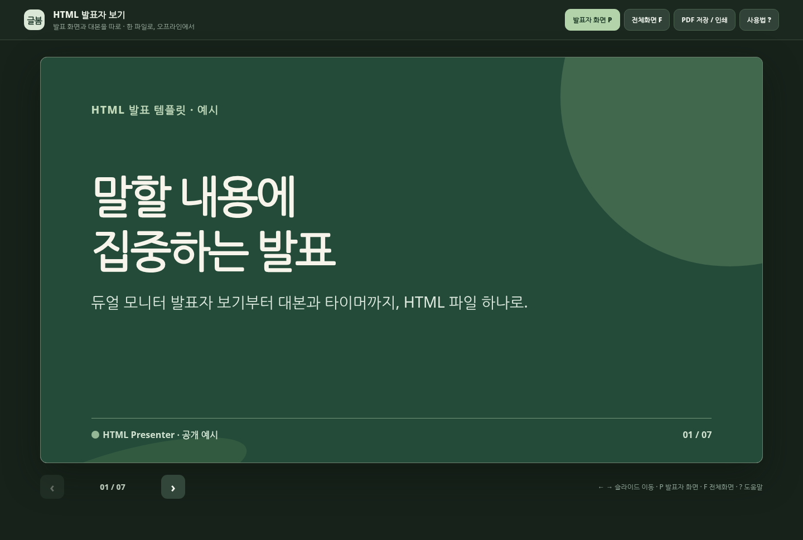
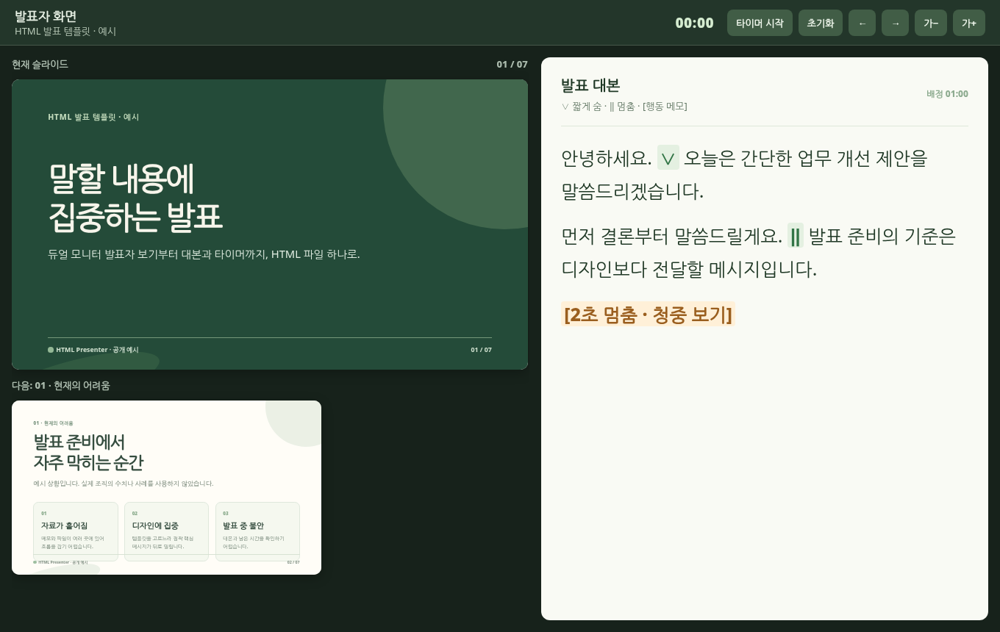

# 글봄 HTML 발표자 보기

프로젝터에는 슬라이드를, 노트북에는 대본과 다음 장을 띄워 발표하세요. 예시 슬라이드 7장과 발표 타이머가 HTML 파일 하나에 들어 있습니다.

[웹에서 바로 실행](https://geulbom-lab.github.io/html-presenter/) · [사용설명서](GUIDE.md)

| 청중 화면 | 발표자 화면 |
| --- | --- |
|  |  |

## 시작하기

1. 웹에서 템플릿을 열고 **발표자 화면**을 누르세요.
2. 모니터를 확장한 뒤 청중 창을 프로젝터로 옮기고 **F**를 눌러 전체화면으로 전환하세요.
3. 노트북의 발표자 창에서 **→**를 누르면 두 화면이 함께 넘어갑니다.

오프라인에서는 저장소의 **Code → Download ZIP**으로 파일을 내려받고 압축을 푼 뒤 `index.html`을 여세요. 내 발표로 바꾸는 방법과 PDF 저장 방법은 [사용설명서](GUIDE.md)에 있습니다.

## 라이선스

[MIT License](LICENSE) · Geulbom Lab
